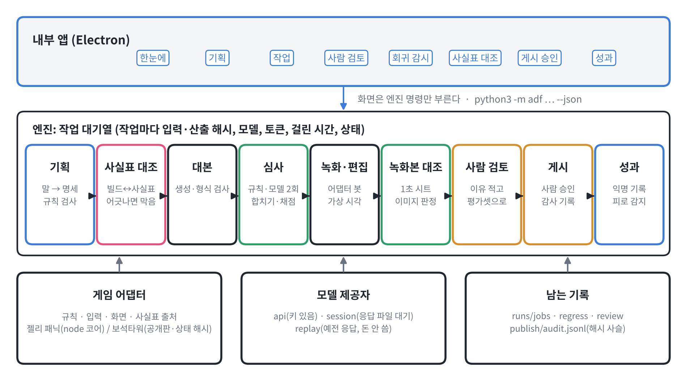
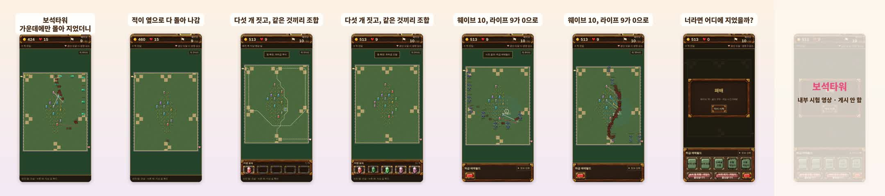
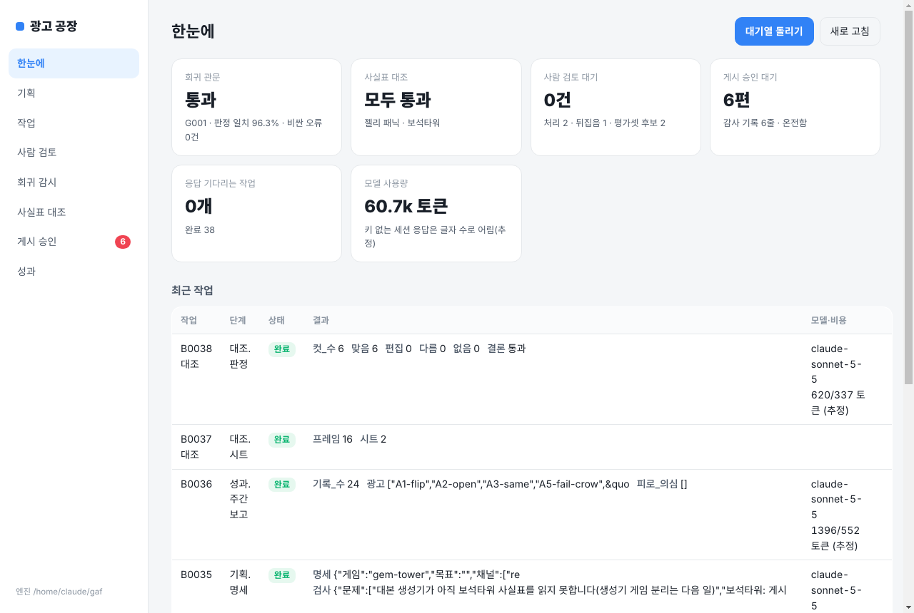
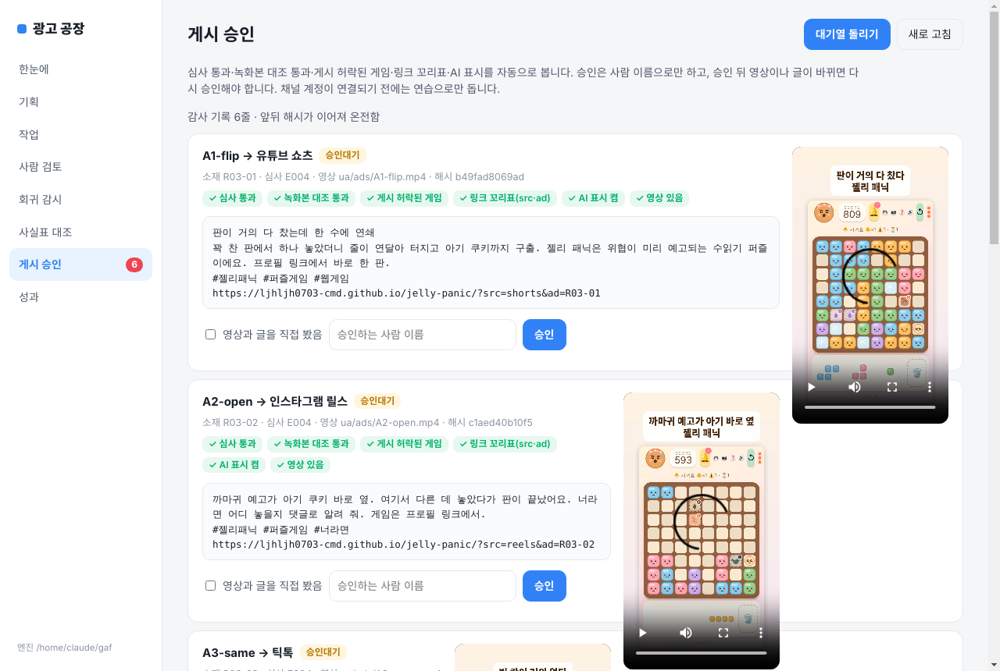

<!-- 광고 공장 2단계: 엔진·게임 어댑터·자동 대조·회귀·검토·기획·게시·익명 기록·내부 앱. 작가 지시 10-22 「순차적으로 해 / 익명 기록 넣고 / 두 번째는 보석타워」. 숫자는 runs/ 와 judge/runs/ 에서 옮김. -->

# 광고 공장: 내부 앱으로 넓힌 기록

작가 지시: 기획자·마케터가 기획부터 제작, 추적, 개선까지 혼자 돌릴 수 있게 운영 흐름을 만들고 내부 앱으로 쓰게 할 것. 게임 두 번째는 보석타워, 젤리 패닉에는 익명 기록을 넣을 것.

## 엔진과 화면을 나눔

흩어져 있던 스크립트(대본 생성, 심사, 녹화본 대조, 녹화, 편집)를 단계로 묶어 한 대기열에서 돌린다. 작업마다 입력 파일 해시, 산출 파일 해시, 모델, 토큰 수, 걸린 시간, 상태를 남긴다. 앱은 엔진 명령만 부르고 따로 계산하지 않는다.

모델 호출은 세 길로 나눴다. 키가 있으면 바로 부르고, 없으면 요청문을 남기고 응답 파일을 기다린다. 예전 응답을 다시 쓰는 길도 두어 돈을 쓰지 않고 합치기와 채점만 다시 볼 수 있다.

옮긴 뒤에도 결과가 같은지 확인했다.

| 확인 | 옮기기 전 | 엔진으로 |
|---|---|---|
| dev 심사(J13 응답 다시 씀) | 일치 98.1%, 카파 0.96 | 98.1%, 0.96 |
| 판 71 녹화 | 프레임 504, 수 54, 소리 207 | 504, 54, 207 (같은 수, 같은 점수) |
| 광고 A1 편집 | 2초 화면 | 픽셀 차이 0 |

## 게임 어댑터, 보석타워 붙이기

게임마다 다른 것을 규칙, 입력, 화면, 사실표 출처 네 부분으로 적게 했다. 젤리 패닉은 녹화기를 이 틀로 다시 짰다.

보석타워를 처음 열어 본 때부터 광고 한 편이 녹화본 대조를 통과할 때까지 약 36분 걸렸다. 사이에 다른 항목 작업이 섞여 있어 순수 시간은 이보다 짧다.

붙이며 찾은 것:

- 첫 주소(/uzmap-forge/)로 열면 판 번호를 버리고 6번 판으로 넘어간다. 판 번호는 web/ 주소에 붙여야 한다. 처음 8판을 돌렸을 때 모두 같은 판이었던 까닭이다.
- 맵이 브라우저 실행기 안에서만 돌아 떼어 낸 시뮬레이터가 없다. 공개판을 6배속으로 끝까지 두며 장면을 찾는다(판 하나에 약 1분).
- 실제 시간으로 두면 수를 두는 틱이 매번 달라 같은 판 번호여도 결과가 갈린다. 그래서 게임이 직접 내는 조작 기록과 상태 해시를 썼다. 장면 바로 앞 틱까지 기록을 잘라 되돌리고, 해시가 같을 때만 녹화한다. 판 1 웨이브 10 장면을 되돌려 녹화했고 결과(골드 513, 패배)가 장면 찾기 때와 같았다.
- 봇은 보석을 가운데에만 몰아 지어 판 8개 모두 웨이브 10에서 졌다. 이 장면으로 답답한 플레이 광고 한 편(16초)을 만들었고, 녹화본 대조에서 컷 6개가 모두 맞았다.

보석타워는 원작 유즈맵 자료를 쓰는 리메이크라 사실표와 어댑터에 게시 불가로 적었다. 이 광고는 내부 시험용이고 게시 단계에서 자동으로 막힌다. 원작 게임 안에 있는 빠칭코·타짜 기능도 광고에 쓰지 않는 것으로 적었다.

### 대본 생성기와 심사기도 게임별로

대본 생성기와 심사기가 젤리 패닉 사실표를 직접 읽던 것을 게임 이름을 받아 `game/<게임>.json` 을 읽게 바꿨다. 회차마다 게임 이름을 남겨 받기 단계와 심사가 같은 사실표를 쓴다. 바꾼 뒤 젤리 패닉 쪽은 연습 묶음의 규칙 결과와 심사 요청문이 마지막 회귀(G001)와 같고, 예전 생성분 R01·R02의 형식 검사도 같다.

보석타워 첫 생성분 G01은 12편(유형 6종 × 2, 세계관 유형은 정한 세계관이 없어 뺌)이 형식 검사를 모두 통과했다. 심사(JG01)는 통과 6 · 사람 확인 5 · 반려 1. 반려는 첫 컷이 평범하게 보석을 짓는 장면이라 위기나 고르는 순간이 없던 것(두 판정 모두 G2). 사람 확인 5개 중 3개는 두 판정이 「다시 보게 되는 끝」에서 엇갈렸고, 2개는 사실표만으로 알 수 없는 게임 동작(조합 뒤 바위가 생기는지, 웨이브 도중에 지을 수 있는지)이라 녹화를 보고 정한다.

처음 심사 요청문을 만들 때 규칙 검사가 「한 등급 위 보석」을 등급 표시(R5)로 두 편 잡았다. 보석 등급은 게임 안 낱말이라 다른 게임에서는 이용가·연령 등급 꼴만 잡게 고쳤고, 젤리 패닉 규칙은 그대로 뒀다.

기준표 1-1에 작가가 10-22에 넣은 「답답한 플레이」 유형이 대본 생성기 유형 목록에 빠져 있어 같이 넣었다.

## 사실표 자동 대조

공개판 소스에서 안내 문구, 판 끝 문구, 화면 요소, 규칙 숫자를 뽑아 사실표와 맞춘다. 어긋나면 심사 묶음 첫 단계에서 막는다.

지금까지 사람이 고친 사실표 판 2~7을 하나씩 되돌려 시험했다. 6개 중 5개를 잡았다. 못 잡은 판 2는 「방벽 없음」처럼 뜻을 읽어야 하는 수정이었다.

처음 돌렸을 때 6판 사실표에서 어긋남 8개가 나왔다. 사람이 이미 「안내 문구 전체」라고 확인했던 판이다.

| 어긋남 | 내용 |
|---|---|
| 빠진 안내 5개 | 사진 고르기, 사진 등록 완료, 스테이지 임무, 디펜스 시작, 그만하기 |
| 판 끝 문구 2개 | 스테이지 임무 완수, 「수를 다 썼어요 — 다시 도전해요」(사실표는 쉼표로 적혀 있었음) |
| 판 번호 숨음 | 세로 700px 이하 화면에서는 판 번호가 보이지 않음 |

사실표를 7판으로 고쳤다. 보석타워 사실표는 소스에서 뽑은 안내 28개와 녹화 화면 확인으로 처음 만들었다. 「광산 도달 시 생명 N 감소」로 바뀌는 표시는 소스 대조로는 잡히지 않았고 녹화 화면에서 찾았다.

## 회귀 감시

기준표, 사실표, 요청문 틀, 규칙 코드, 모델, 검토 묶음의 해시를 지문으로 둔다. 하나라도 바뀌면 dev 와 검토 묶음을 다시 심사하고, 반려를 통과시킨 것이 하나라도 나오면 막는다. 숨긴 묶음은 자주 보면 거기에 맞춰 고치게 되므로 배포 전 확인에서만 돌린다.

사실표 7판으로 바뀐 것을 잡아 첫 회귀(G001)가 돌았다. 모델 판정 두 번은 응답 파일을 기다리는 길로 받았다.

| 회차 | 바뀐 것 | dev 일치 | 카파 | 비싼 오류 | 검토 묶음 | 관문 |
|---|---|---|---|---|---|---|
| G000 (J13) | 기준점 | 98.1% | 0.96 | 0 | | 통과 |
| G001 | 사실표, 검토 묶음 | 96.3% | 0.922 | 0 | 2/2 | 통과 |

dev 가 1.8%p 내려간 것은 사람 확인으로 넘긴 소재가 하나 늘어서다(통과를 반려로 바꾼 것 없음).

## 사람 검토

심사에서 사람 확인으로 끝난 소재가 대기열로 간다. 결정에는 이유를 꼭 적고, 반려면 걸린 조건을 적는다. 결정한 소재는 평가셋 후보로 들어가 다음 회귀부터 함께 돈다.

둘째 생성분(R02)을 엔진으로 다시 심사해 시험했다. 사진 고르기 화면을 묻던 R02-08은 공개판 코드를 근거로 통과로 정했고, 예전에 통과로 나간 R02-04는 사람이 반려로 뒤집었다. 대기열은 이것을 비싼 오류 1건으로 센다. 두 소재 모두 G001 검토 묶음에서 맞게 판정됐다.

## 대화형 기획

말로 쓴 요청을 명세(게임, 목표, 채널, 유형, 개수, 유료 여부)로 바꾸고 규칙으로 검사한다. AI가 덧붙인 질문은 보여 주되 진행을 막지 않고, 규칙이 정한 빈 값과 문제만 막는다.

| 요청 | 결과 |
|---|---|
| 젤리 패닉 틱톡·쇼츠 6개, 질 뻔하다 뒤집기 위주, 무료, 첫 판 늘리기 | 바로 넣을 수 있음 |
| 보석타워 릴스 5개, 국내 1위라고 넣고 유료 30만원 | 문제 2개(게시 불가 게임이라 시험용 대본만, 근거 없는 순위), 유료는 사람 승인. 처음엔 대본 생성기가 보석타워를 못 읽어 막혔고, 게임 분리 뒤 풀림 |

## 게시 승인과 감사 기록

요청할 때 심사 통과, 녹화본 대조 통과, 게시 허락된 게임, 링크 꼬리표, AI 표시를 자동으로 본다. 승인은 사람 이름으로만 받고 그때의 영상·글 해시를 묶는다. 승인 뒤 영상이나 글이 바뀌면 실행을 막는다. 감사 기록은 줄마다 앞 줄 해시를 품어 중간 줄을 고치면 검사에서 드러난다. 이 네 가지를 임시 폴더에서 시험했다.

채널 계정이 없어 업로더는 비워 두었고, 지금은 연습으로만 기록한다. 광고 6편은 점검을 모두 통과해 승인 대기다.

## 익명 기록과 성과 보고

젤리 패닉에 판 시작, 첫 수, 판 끝, 다시 하기 네 가지를 남기는 기록을 넣었다. 탭마다 새 무작위 번호와 광고 꼬리표, 그 판의 숫자만 보낸다. 이름·사진·기기 식별자·쿠키는 보내지 않고, Do Not Track·Global Privacy Control·?notrack 이면 끈다. 수집 주소가 비어 있으면 아무것도 보내지 않는다. 공개 저장소에는 아직 올리지 않았다(작가 「올려」 뒤).

수집기는 약속한 항목만 남기고 나머지는 버린다. 봇 7판을 게임→수집기→파일로 흘려 기록 24줄이 빠짐없이 들어온 것을 확인했다. 처음엔 다시 하기 기록이 빠졌는데, 탭을 닫을 때 남은 묶음을 보내는 처리를 더해 고쳤다.

주간 보고는 광고별 첫 수 비율, 다시 하기 비율, 놓은 수를 묶고, 하루 지표가 최고 3일 평균의 70% 아래로 내려가면 소재 피로로 본다. 노출이 같이 줄어든 경우는 피로로 보지 않는다. 시작 30판 미만은 숫자만 옮기고 판단하지 않는다. 봇 기록으로 돌린 보고에서 AI는 표본이 작다며 판단을 하지 않았다.

## 내부 앱

Electron 으로 여덟 화면(한눈에, 기획, 작업, 사람 검토, 회귀 감시, 사실표 대조, 게시 승인, 성과)을 만들었다. 화면은 허용한 엔진 명령만 부를 수 있다. 실제 창을 띄워 화면마다 찍고, 「직접 봤음」 체크 없이 승인하면 막히는 것까지 확인했다.

## 남은 한계

- 보석타워 봇은 미로를 짓지 못해 웨이브 10을 넘지 못한다. 이긴 장면이나 아슬아슬한 장면은 아직 없다.
- 사실표 자동 대조는 함수 이름과 변수 이름으로 글자를 찾는다. 다른 방식으로 띄우는 글자(오류 안내 등)는 놓친다.
- 키 없이 받은 응답의 토큰 수는 글자 수로 어림했다. 달러는 확인한 가격이 없어 비워 두었다.
- 채널 업로더와 수집기 배포는 계정·배포 승인 전이라 시험하지 않았다.
- 앱은 맥용 설치 파일로 묶지 않았다. 맥에서 npm start 로 띄운다.
