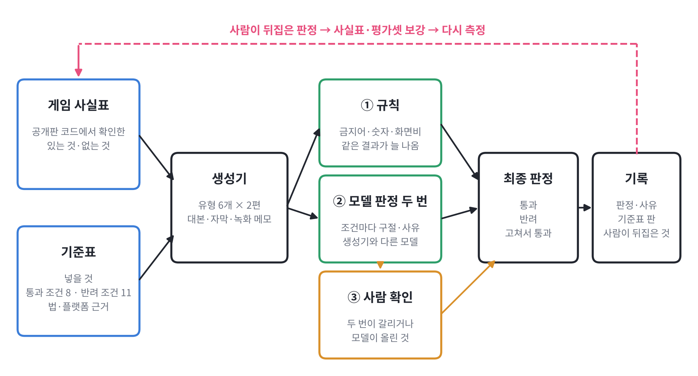
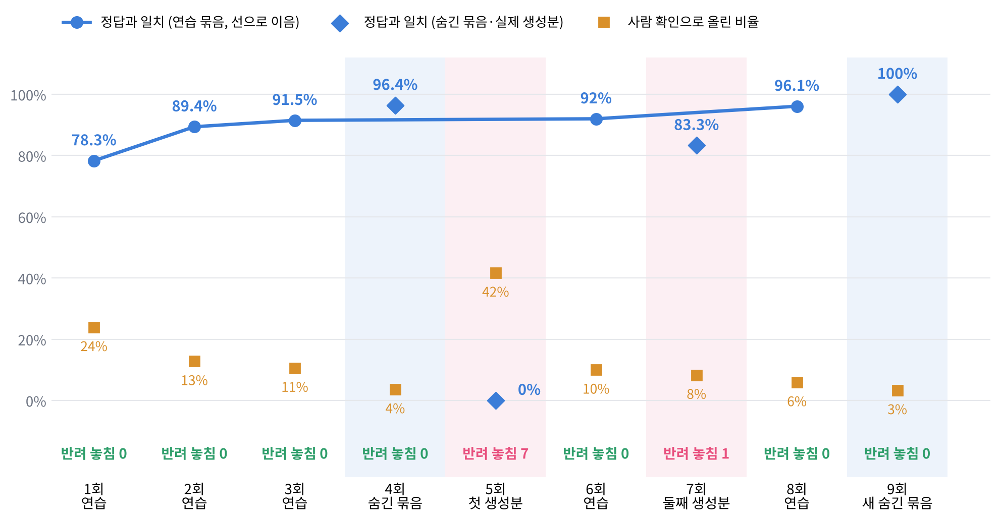
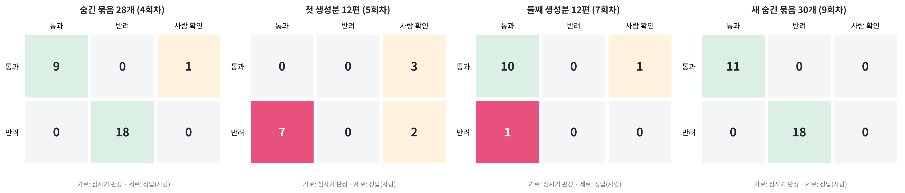
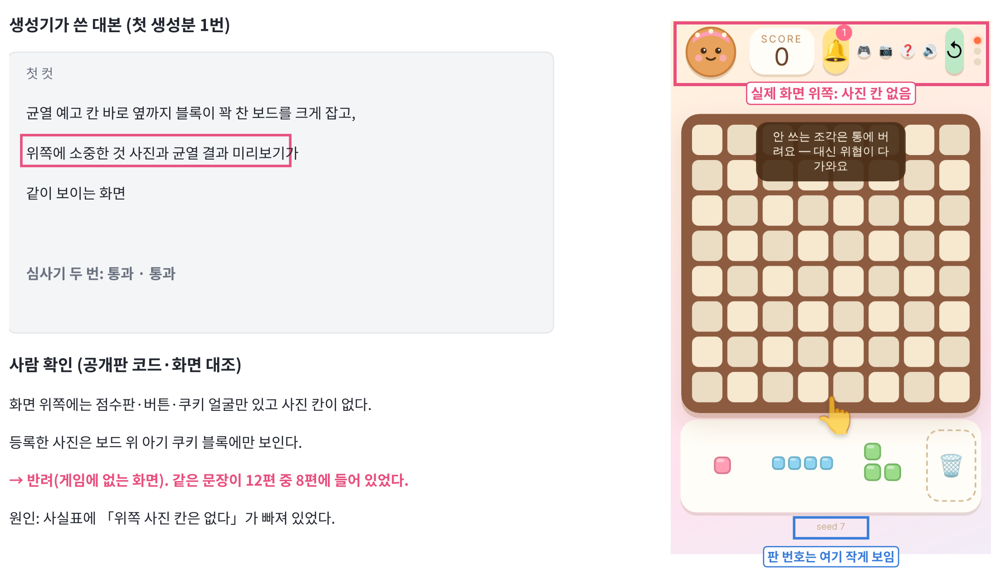
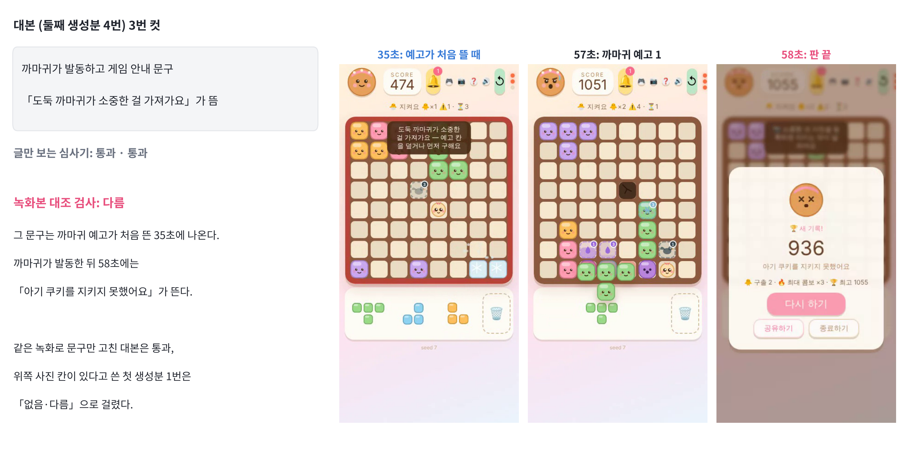
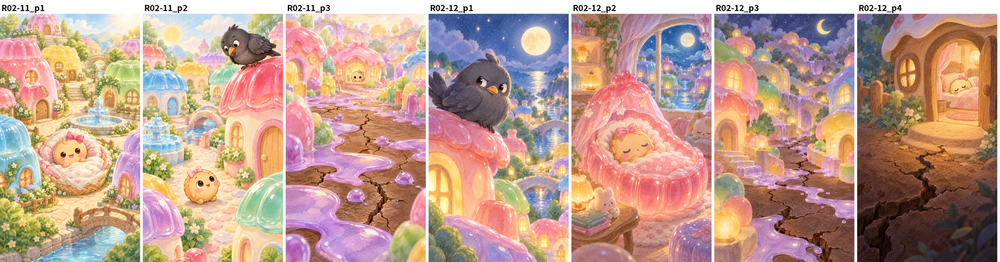
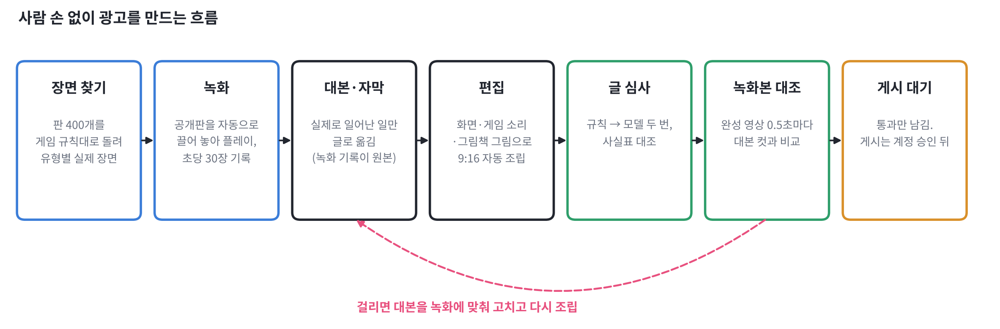

<!-- 광고 소재 공장 1단계 진행 기록. 작가 지시 10-22 「과정 잘 기록해 시각자료 포함」. 숫자는 judge/runs/*/score.json 에서 옮김. -->

# 젤리 패닉 광고 소재 공장: 진행 기록

젤리 패닉(웹 퍼즐 게임)의 무료 숏폼 광고 대본을 AI로 만들고, 내보내기 전에 AI 심사기로 거르는 흐름을 만들었다. 이 기록은 기준을 세우고, 정답이 붙은 시험 묶음으로 심사기를 재고, 실제 생성분에서 놓친 것을 찾아 고친 순서를 숫자 그대로 남긴다.

## 01. 흐름

- 게임 사실표: 공개판 코드와 실제 화면에서 확인한 게임에 있는 것과 없는 것. 생성기와 심사기가 같은 사실표를 본다.
- 기준표: 광고에 넣을 것, 통과 조건 8개, 반려 조건 11개. 반려 조건은 게임산업법 제34조, 표시광고법, 추천·보증 심사지침, 틱톡·유튜브·메타의 AI 표시 정책, 영국 광고 심의 기구(ASA)의 모바일 게임 광고 지침에서 가져왔다.
- 생성기: 영상 유형 6개(질 뻔하다 뒤집기, 열린 끝, 선택 순간, 손 화면·반응, 같은 판 도전, 세계관 도입)마다 2편씩 대본을 쓴다. 생성은 Opus.
- 심사기: ① 금지어·숫자·화면비 같은 규칙 검사, ② 다른 모델(Sonnet)이 조건마다 위반 여부와 근거 구절을 두 번 판정, ③ 두 번이 갈리거나 모델이 스스로 올린 것은 사람이 본다.
- 사람이 뒤집은 판정은 기록으로 남기고, 그 원인을 사실표와 평가셋에 다시 넣는다.

## 02. 평가셋

- 정답이 붙은 소재 79개. 연습 묶음(dev) 51개로 요청문과 사실표를 고치고, 숨긴 묶음(holdout) 28개는 설정을 고정한 뒤 한 번만 돌렸다.
- 9회차에 쓴 새 숨긴 묶음 30개는 따로 지었다(03 참고). 합치면 109개.
- 반려 조건마다 2개 이상, 연습 묶음에 1개 이상 들어가게 짰다. 게임에 없는 장면(R1)이 20개로 가장 많다. 실제 생성분에서 가장 자주 나온 문제도 이것이었다.
- 정답은 기준표를 쓴 쪽이 붙였다. 첫 판은 독립 검토에서 74개 중 67개가 일치했고, 갈린 7개는 공개판 코드와 기준표로 다시 판정했다.

## 03. 점수 변화

| 회차 | 묶음 | 소재 | 정답과 일치 | 반려 놓침 | 사람 확인 비율 | 바꾼 것 |
|---|---|---|---|---|---|---|
| 1 | 연습 | 46 | 78.3% | 0 | 23.9% | 첫 판 |
| 2 | 연습 | 47 | 89.4% | 0 | 12.8% | 판정 메모 추가(앞부분 장면, 가짜 아까운 패배의 뜻) |
| 3 | 연습 | 47 | 91.5% | 0 | 10.6% | 기능 문구는 사실표에 있는 것만 |
| 4 | 숨긴 묶음 | 28 | 96.4% | 0 | 3.6% | 설정 고정, 한 번만 |
| 5 | 첫 생성분 | 12 | 0% | 7 | 41.7% | 실제 대본에 처음 적용 |
| 6 | 연습 | 50 | 92.0% | 0 | 10.0% | 사실표 고침, 놓친 유형 추가 |
| 7 | 둘째 생성분 | 12 | 83.3% | 1 | 8.3% | 정답을 먼저 붙이고 심사 |
| 8 | 연습 | 51 | 96.1% | 0 | 5.9% | 놓친 유형 하나 더 추가 |
| 9 | 새 숨긴 묶음 | 30 | 100% | 0 | 3.3% | 설정 고정, 한 번만 |
| 10 | 연습 | 54 | 98.1% | 0 | 3.7% | 기준표 변경(답답한 플레이 허용) 뒤 다시 잼, 새 유형 소재 3개 추가 |

- 반려 놓침: 사람이 반려로 본 소재를 심사기가 통과로 내보낸 수. 광고가 그대로 나가는 오류라서 가장 먼저 본다. 사람 확인으로 올린 것은 놓침으로 세지 않는다.
- 5회차 정답은 심사기 결과를 본 뒤 사람 확인에서 붙였다. 7회차는 심사기를 돌리기 전에 정답을 먼저 고정해서 독립 측정이 된다.
- 9회차 묶음은 심사기를 고친 세션과 따로, 다른 모델 세션(Opus)이 기준표와 사실표만 읽고 소재 30개와 정답을 지었다. 또 다른 세션이 정답을 지운 채 다시 판정해 30개 중 29개가 같았고, 갈린 1개(「운빨 블록 퍼즐은 이제 그만」)는 비교·비방(R3)으로 보고 반려로 정했다.
- 9회차는 30개 모두 맞았지만 표본이 30개라 실제 일치율은 89% 아래일 수도 있다(95% 신뢰구간 하한). 이 묶음을 지은 세션도 같은 사실표를 읽었기 때문에, 사실표에 적힌 함정은 잘 잡고 사실표에 없는 함정은 재지 못한다. 사실표 밖의 오류는 7회차처럼 실제 생성분에서 드러났다.

## 04. 실제 생성분에서 놓친 것

연습 묶음과 숨긴 묶음에서는 반려를 하나도 통과시키지 않았다. 생성기가 쓴 실제 대본 12편에 처음 돌리자 사람이 반려로 본 9편 가운데 7편이 통과로 나왔다.

- 대본 8편에 「위쪽에 소중한 것 사진」이 들어 있었다. 게임 화면 위쪽에는 점수판과 버튼, 쿠키 얼굴만 있고 사진 칸이 없다. 등록한 사진은 보드 위 아기 쿠키 블록에만 보인다.
- 생성기는 사진 위치를 잘못 적었던 옛 사실표로 대본을 썼다.
- 심사기가 쓰는 고친 사실표에도 「위쪽 사진 칸은 없다」가 없었다. 화면 목록에 사진 등록 버튼이 있어서 두 번 다 있을 법하다고 봤다. 사실표에 없다고 적지 않은 것은 모델이 있다고 본다.
- 사람 확인으로 올라온 5편 중 4편은 코드로 답이 나왔다. 구출 뒤 새 아기 쿠키는 조각 12번 뒤에 다시 나온다. 이것도 사실표에 없던 내용이다.

고친 뒤 둘째 생성분 12편은 정답을 먼저 붙이고 심사했다. 11편 통과가 맞았고 반려 1편을 놓쳤다.

- 놓친 대본은 까마귀가 발동해 판이 끝나는 순간에 「도둑 까마귀가 소중한 걸 가져가요」 문구가 뜬다고 적었다. 이 문구는 까마귀가 처음 나올 때 한 번 뜨는 안내이고, 판이 끝날 때는 「아기 쿠키를 지키지 못했어요」가 뜬다.
- 사실표에는 이 문구가 까마귀 설명 옆에 붙어 있었고 언제 뜨는지가 없었다. 사실표 5판에 안내 문구가 뜨는 때와 판 끝 문구 세 가지를 넣고, 같은 유형을 연습 묶음에 추가했다.
- 고친 뒤 연습 묶음 51개를 다시 재니 일치 96.1%, 반려 놓침 0, 사람 확인 5.9%였다. 앞서 놓친 두 유형(위쪽 사진 칸, 안내 문구가 뜨는 때)은 두 번 모두 반려로 잡았다.
- 같은 회차에서 규칙 검사가 12편 모두를 숫자 위반으로 반려했다. 끝 문구의 링크 주소 속 숫자를 잡은 오탐이다. 링크 주소를 빼고 검사하도록 고쳤고, 연습 묶음과 숨긴 묶음의 규칙 결과는 바뀌지 않았다. 위 표의 7회차 숫자는 고친 뒤 값이고, 고치기 전 결과도 따로 남겼다.

## 05. 녹화본 대조 검사

심사기는 대본 글만 본다. 안내 문구가 언제 뜨는지, 화면 위쪽에 무엇이 있는지는 녹화 화면에서만 확인된다. 그래서 대본과 녹화본을 맞춰 보는 검사를 하나 더 붙였다.

- 공개판 게임을 브라우저에서 마우스로 끌어 놓아 실제로 한 판 플레이하고 녹화했다. 수 계산은 같은 판 번호로 만든 복제 판에서 하고, 입력은 화면 드래그로만 했다. 55수 동안 점수가 복제 판과 한 번도 어긋나지 않았고, 판은 까마귀가 아기 옆에서 발동해 끝났다.
- 녹화를 1초마다 잘라 8장씩 모은 시트를 만들고, 이미지를 읽는 모델이 대본의 컷마다 「맞음·다름·없음·편집」을 판정한다. 다름·없음이 하나라도 있으면 사람 확인으로 올린다.
- 같은 녹화로 대본 세 편을 대조했다.

| 대본 | 글 심사 | 녹화본 대조 | 걸린 곳 |
|---|---|---|---|
| 둘째 생성분 4번(원본) | 통과 | 사람 확인 | 3번 컷 문구: 실제로는 예고가 처음 뜬 35초에 나오고 판 끝(58초)에는 「아기 쿠키를 지키지 못했어요」 |
| 같은 대본, 3번 컷 문구만 고침 | 통과 | 통과 | 없음 |
| 첫 생성분 1번 | 통과 | 사람 확인 | 위쪽 사진 칸 없음, 보드가 꽉 찬 장면 없음 |

- 첫 판 요청문에서는 「되감아 멈춤」 같은 편집 컷을 「없음」으로 걸었다. 편집 동작은 「편집」으로 따로 판정하고 돌아갈 장면이 녹화에 있는지만 보도록 고친 뒤 세 편을 다시 돌린 결과가 위 표다. 첫 판 답도 남겼다.
- 시연용 녹화는 자동 플레이 한 판이다. 실제 광고 녹화는 작가 폰 화면 녹화이고, 같은 검사를 그대로 쓴다.

## 06. 세계관 그림책 그림

- 글 심사와 사람 확인을 통과한 세계관 대본 두 편(둘째 생성분 11번, 12번)의 그림 요청문 7개를 웹 ChatGPT에서 한 장에 새 대화 하나씩 뽑았다. 거절 0, 7장 모두 받았다.
- 요청문에는 게임 속 생김새를 글로 적었다. 아기 쿠키는 살구빛 크림색 얼굴과 분홍 볼, 머리 위 분홍 리본, 도둑까마귀는 통통한 짙은 회색에 주황 부리, 시럽은 연보라 방울, 균열은 짙은 갈색 바닥의 금. 실제 게임 화면 캡처에서 옮겨 적었다.
- 7장 모두 눈으로 확인했다. 파일 이름과 장면이 맞고, 글자·로고·사람 얼굴이 없고, 까마귀가 아기에 닿거나 물고 가는 장면이 없다. 아기 쿠키 생김새는 게임과 같은 계열이지만 그림책 쪽이 더 둥글고 크다. 게임 화면과 헷갈리지 않아야 한다는 조건에는 맞는 차이다.
- 받은 7장 모두 파일 안에 생성 정보(C2PA)가 남아 있다. 지우지 않고 올린다(반려 조건 R8).

## 07. 사람 손 없이 만든 광고 4편

작가 지시(10-22): 광고는 사람 손을 타지 않고 AI로만 만든다. 그래서 녹화도 사람 폰 대신 자동 플레이로 바꾸고, 편집·검사까지 한 흐름으로 묶었다.

- 장면 찾기: 공개판과 같은 게임 규칙 코드로 판 400개를 자동 플레이해서, 유형마다 실제로 일어난 장면을 골랐다. 꽉 찬 판에서 한 수에 연쇄(판 71), 까마귀가 아기 옆에서 발동해 진 판(판 327), 빈 칸이 없어 끝난 판(판 379), 아기 옆 까마귀 예고 뒤 구출(판 118).
- 녹화: 공개판을 브라우저에서 자동으로 끌어 놓아 플레이하면서, 페이지 시간을 멈춰 가며 1/30초씩 진행시켜 한 장씩 고해상도로 찍었다. 모든 판에서 화면 점수와 복제 판 점수가 끝까지 같았다.
- 소리: 게임이 내는 효과음은 코드로 합성하는 음이라, 녹화 중 게임이 낸 음의 높이·길이·크기·시각을 그대로 기록해 같은 값으로 다시 합성했다. 배경 음악은 넣지 않았다.
- 대본: 녹화 기록에 실제로 일어난 일만 자막과 대본으로 옮겼다. 원본은 녹화 기록으로 둔다.
- 편집: 편집 결정표(JSON) 하나로 9:16 영상을 다시 만들 수 있다. 자르기, 멈춤, 빠른 되감기, 그림책 페이지 넘김, 끝 화면만 쓰고 게임 화면 내용은 바꾸지 않는다.

| 광고 | 유형 | 길이 | 글 심사 1판 | 녹화본 대조 1판 | 최종 |
|---|---|---|---|---|---|
| 꽉 찬 판 연쇄 | 질 뻔하다 뒤집기 | 7.1초 | 사람 확인(상태 줄이 사실표에 없음) | 통과 | 통과 |
| 까마귀 앞에서 진 판 | 열린 끝 | 8.2초 | 통과 | 다름(조각 놓은 자리) | 통과 |
| 빈 칸 없는 판 | 같은 판 도전 | 7.2초 | 사람 확인(첫 컷 아기 여부) | 다름(판 번호 안 보임) | 통과 |
| 그림책 아기 쿠키 | 세계관 도입 → 실제 플레이 | 13.7초 | 사람 확인(마카롱 안내가 사실표에 없음) | 통과 | 통과 |

- 걸린 것은 모두 고쳐서 다시 돌렸다. 글 심사 3판, 녹화본 대조는 광고마다 2~3판을 남겼다.
- 까마귀 광고: 대본을 쓴 AI(이 세션)가 「아래쪽 빈 칸에 놓음」이라고 적었는데, 녹화에서는 위쪽 줄의 균열 예고 칸을 덮었다. 녹화본 대조가 잡았고, 대본과 자막을 녹화에 맞춰 고쳤다.
- 판 번호: 처음 편집에서 게임 화면을 판 번호 줄 위에서 잘랐다. 고친 뒤에도 검사기가 시트를 만들며 아래 14%를 잘라 또 안 보였다. 둘 다 고쳐 판 번호가 보이는 것을 확인했다.
- 사람 확인 3건은 공개판 코드에서 상태 줄과 안내 문구 전체를 찾아 사실표 6판에 넣어 풀었다. AI만으로 돌리는 동안 사람 확인으로 남는 소재는 게시하지 않고 보류한다.
- 「손 화면·반응」 유형은 실제 사람 손과 반응이 있어야 성립해서 AI만으로는 만들지 않았다. 지어낸 반응은 반려 조건(R6)이다.
- 게시글과 채널별 출처 태그 링크는 만들어 두었다. 같은 판 도전 광고 링크에는 판 번호(?seed=379)를 붙였다. 게임 전용 계정을 만들고 올리는 일은 작가 승인 뒤에 한다.

### 답답한 플레이 광고 2편

작가 결정(10-22): 다른 게임 광고의 「내가 하면 더 잘하겠다」 실패 광고 방식을 쓰되, 화면은 실제 게임 그대로 두고 일부러 못 둔 판만 쓴다. 게임에 없는 장면을 보여 주는 실패 광고는 게임산업법 제34조(게임 내용과 다른 광고)와 영국 광고 심의 기구의 판정 사례에 걸려서 쓰지 않는다.

- 기준표: 영상 유형에 「답답한 플레이」를 넣고, 가짜 연출의 뜻을 「화면을 편집으로 바꾸거나 두지 않은 수를 둔 것처럼 보여 주는 것」으로 좁혔다. 문구는 운영자 목소리로 쓰고, 일반 사용자가 못 둔 것처럼 꾸미면 반려(R6)로 남겼다.
- 기준을 바꾼 뒤 연습 묶음을 다시 쟀다(10회차, 98.1%). 새 유형으로 통과 1개, 반려 2개(엄마 플레이로 꾸민 문구, 틀린 칸에 정답 표시)를 넣었고 셋 다 맞혔다.
- 장면 찾기: 판 400개 중에서 한 수로 막을 수 있는 까마귀를 두고 진 순간(판 254), 놓으면 줄이 한꺼번에 지워지는 칸을 두고 막힌 순간(판 138)을 골랐다. 정답 칸은 같은 판을 게임 규칙으로 돌려 실제로 막히고 지워지는 것을 확인한 칸이다.
- 영상: 멈춘 화면에 정답 칸 표시 → 운영자가 일부러 엉뚱한 칸에 놓음 → 실제 판 끝 → 되감아 「너라면 바로 보임?」과 정답 표시. 두 편 모두 글 심사와 녹화본 대조를 한 번에 통과했다.
- 녹화본 대조는 정답 표시를 편집으로 보고 넘긴다. 표시가 맞는 칸을 가리키는지는 위의 규칙 시뮬레이션으로만 확인했다.

## 08. 사실표가 바뀐 기록

| 판 | 바꾼 것 | 찾은 곳 |
|---|---|---|
| 1 | 처음 작성 | |
| 2 | 소중한 것 = 보드 위 아기 쿠키 블록, 방벽 없음, 판이 끝나는 경우 세 가지, 공유 버튼은 그림만 | 공개판 코드 |
| 3 | 화면 위쪽 사진 칸 없음, 아기가 다시 나오는 조건 | 첫 생성분 사람 확인 |
| 4 | 판 번호가 조각 자리 아래에 작게 보임 | 실제 화면 캡처 |
| 5 | 안내 문구가 뜨는 때, 판 끝 문구 | 둘째 생성분 사람 확인 |
| 6 | 상태 줄, 안내 문구 전체 목록 | AI 광고 글 심사 사람 확인 |

4판은 기록용 화면을 캡처하다가 찾았다. 그 전까지 사실표에는 판 번호가 화면에 안 보인다고 적혀 있었다.

## 09. 남은 한계

- 생성기와 심사기가 같은 회사 모델이다. 다른 회사 모델을 심사기로 붙여 비교하지 못했다.
- 정답은 기준표를 쓴 쪽이 붙였다. 작가의 독립 검토가 남아 있다.
- 새 숨긴 묶음(9회차)도 사실표를 읽고 지은 묶음이라 사실표 밖의 함정은 재지 못한다. 실제 생성분을 더 모아 사람 정답을 먼저 붙여 재는 쪽이 더 믿을 만하다.
- 녹화본 대조 검사는 대본 7편에 돌렸다. 검사 모델이 놓치는 경우를 재려면 일부러 틀린 영상을 섞은 시험 묶음이 따로 필요하다.
- 자동 플레이는 한 가지 규칙으로 수를 고른다. 사람이 두는 수와 다를 수 있지만, 화면은 모두 게임이 실제로 그린 그대로다.
- 실제 생성분 표본이 24편이다. 놓침 비율을 말하려면 더 많이 돌려야 한다.

## 10. 다음

- 게임 전용 계정을 만들고 광고 6편을 올린다(작가 승인 뒤). 승인은 앱의 게시 승인 화면에서 한다.
- 젤리 패닉 익명 기록을 공개 저장소에 올리고 수집기를 배포한다(작가 「올려」와 배포 승인 뒤).
- 게시 뒤 채널별 반응을 링크 출처 태그로 모아 2단계 성과 리포트를 쓴다.

## 11. 내부 앱으로 넓힘

엔진과 화면을 나누고, 게임 두 번째(보석타워)를 붙이고, 사실표 자동 대조·회귀 감시·사람 검토·대화형 기획·게시 승인·익명 기록·내부 앱을 만들었다. 기록은 [[applications/_portfolio/game-ad-factory/EXTENSION]]에 따로 둔다.

